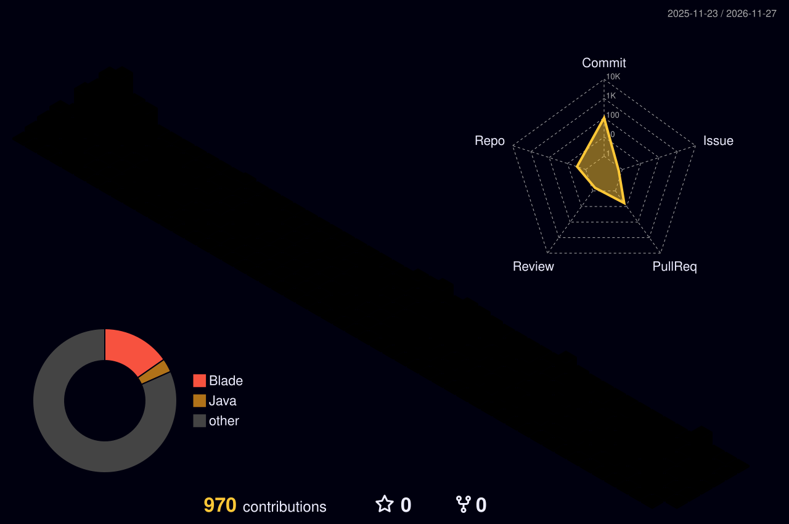

<table align="center" width="100%" cellpadding="0" cellspacing="0" style="background: linear-gradient(90deg, #1f2430 0%, #58a6ff 100%); border-radius: 8px; padding: 25px 0; text-align: center;">
  <tr>
    <td>
      <h1 style="color: #ffffff; font-size: 32px; font-weight: 700; margin: 0 0 10px 0; font-family: -apple-system, BlinkMacSystemFont, 'Segoe UI', Roboto, sans-serif;">Shoresh Nick Narowen</h1>
      
Web &amp; Mobile App Developer

    </td>
  </tr>
</table>

  

  
  

### 01 · About

<table width="100%" style="background-color: #1f2430; border-radius: 6px; border-collapse: separate; border-spacing: 0;">
  <tr>
    <td width="100" align="left" style="padding: 10px; border-bottom: 1px solid #2d3748;"><b>overview</b></td>
    <td style="padding: 10px; border-bottom: 1px solid #2d3748;">Passionate about building modern <b>web</b> and <b>mobile applications</b> with clean, scalable code.</td>
  </tr>
  <tr>
    <td width="100" align="left" style="padding: 10px; border-bottom: 1px solid #2d3748;"><b>stack</b></td>
    <td style="padding: 10px; border-bottom: 1px solid #2d3748;">Experienced in <b>Laravel, Filament, PHP, JavaScript, MySQL, TailwindCSS, Python</b> and <b>mobile app development (Android & iOS)</b>.</td>
  </tr>
  <tr>
    <td width="100" align="left" style="padding: 10px; border-bottom: 1px solid #2d3748;"><b>focus</b></td>
    <td style="padding: 10px; border-bottom: 1px solid #2d3748;">Skilled in developing <b>websites, web-based applications (MIS), admin dashboards, and mobile apps</b>. Exploring <b>Swift, SwiftUI, Kotlin & Java</b> to expand cross-platform mobile skills.</td>
  </tr>
  <tr>
    <td width="100" align="left" style="padding: 10px;"><b>note</b></td>
    <td style="padding: 10px;"><i>Most of my feature projects are still under progress. Feel free to explore or reach out for collaborations!</i></td>
  </tr>
</table>

### 02 · Tech stack

<table width="100%" cellpadding="0" cellspacing="0">
  <tr>
    <td width="180" align="left"><b>LANGUAGES</b></td>
    <td width="100%">
      
      
      
      
      
      
    </td>
  </tr>
  <tr>
    <td width="180" align="left"><b>FRAMEWORKS & UI</b></td>
    <td width="100%">
      
      
      
      
      
      
      
    </td>
  </tr>
  <tr>
    <td width="180" align="left"><b>MOBILE</b></td>
    <td width="100%">
      
      
    </td>
  </tr>
  <tr>
    <td width="180" align="left"><b>DATABASES</b></td>
    <td width="100%">
      
      
      
      
    </td>
  </tr>
  <tr>
    <td width="180" align="left"><b>DEVOPS & TOOLS</b></td>
    <td width="100%">
      
      
      
      
    </td>
  </tr>
</table>

## 03 · Contribution

  <picture>
    <source media="(prefers-color-scheme: dark)" srcset="./profile-3d-contrib/profile-night-rainbow.svg" />
    <source media="(prefers-color-scheme: light)" srcset="./profile-3d-contrib/profile-green-animate.svg" />
    
  </picture>

## 04 · Stats & Metrics

<table width="100%" cellpadding="0" cellspacing="0">
  <tr>
    <td width="50%" align="center">
      
    </td>
    <td width="50%" align="center">
      
    </td>
  </tr>
</table>

  

### 05 · Links

  
  
  

 

  <picture>
    <source media="(prefers-color-scheme: dark)" srcset="https://raw.githubusercontent.com/nshoresh/nshoresh/output/github-snake-dark.svg" />
    <source media="(prefers-color-scheme: light)" srcset="https://raw.githubusercontent.com/nshoresh/nshoresh/output/github-snake.svg" />
    
  </picture>

